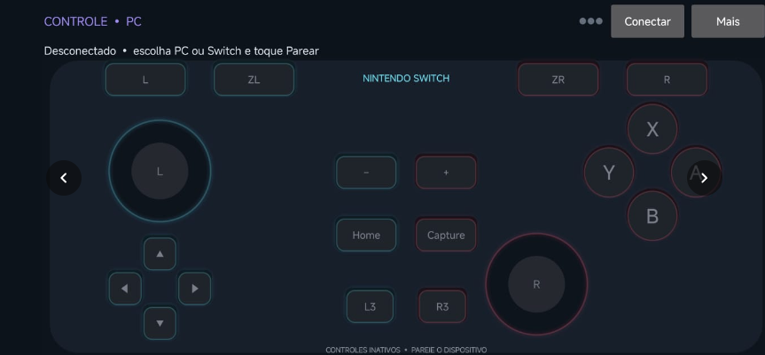
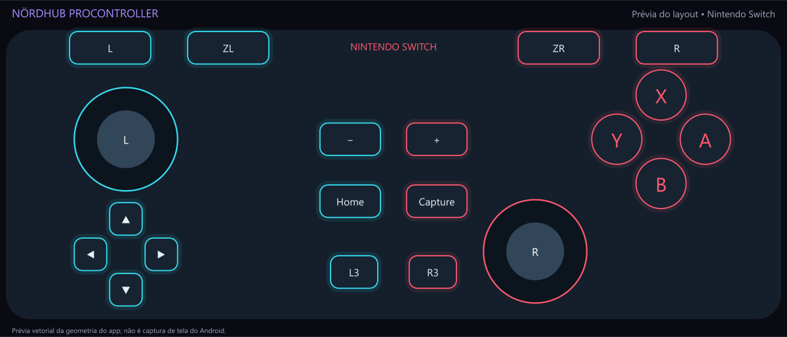
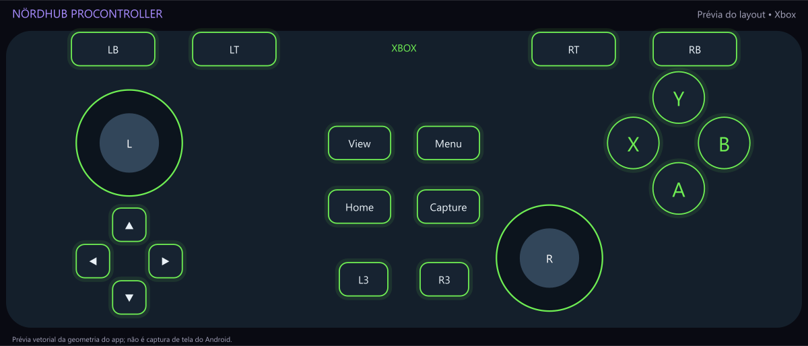
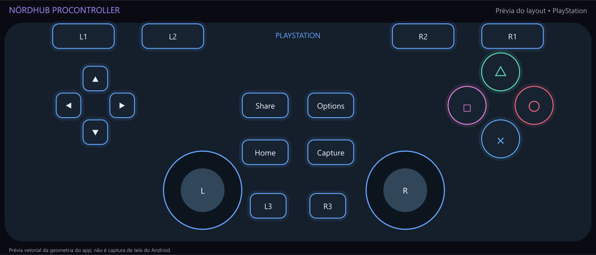

# Nördhub ProController

Transforme seu celular Android em um controle de tela para computadores Windows e Nintendo Switch com MissionControl. Escolha entre os layouts **Nintendo, Xbox e PlayStation**, ajuste os comandos ao seu jeito e conecte ao PC por **Bluetooth ou Wi-Fi local**.

**Versão 0.3.1 · experimental · Android 9 ou superior.** Os nomes dos layouts descrevem a aparência dos botões. O app não oferece pareamento direto com consoles físicos Xbox, PS4 ou PS5.

## Downloads

| Download | Conteúdo |
|---|---|
| [Instalar o APK Android 0.3.1](https://github.com/EriclesSantos/nordhub-procontroller/releases/download/v0.3.1/nordhub-procontroller-0.3.1.apk) | App para celular ou portátil Android. |
| [Baixar o auxiliar Windows x64](https://github.com/EriclesSantos/nordhub-procontroller/releases/download/v0.3.1/nordhub-procontroller-pc-0.3.1.zip) | Recebe os comandos e cria um controle Xbox virtual para jogos. |
| [Baixar o código-fonte](https://github.com/EriclesSantos/nordhub-procontroller/releases/download/v0.3.1/nordhub-procontroller-source-0.3.1.zip) | Fontes Android/Windows, testes e documentação. |
| [Conferir SHA-256 dos arquivos](https://github.com/EriclesSantos/nordhub-procontroller/releases/download/v0.3.1/SHA256SUMS.txt) | Verificação de integridade dos downloads. |

Quem já usa **Nördhub ProController 0.2.8 ou superior** pode instalar a atualização por cima, preservando os ajustes. Para migrar de **SwitchPhone 0.2.7 ou anterior**, desinstale o app antigo e instale o APK novo, pois a assinatura de distribuição mudou naquela migração.

## Começar a jogar

- **Desktop ou notebook:** siga o [guia para computadores Windows](docs/computadores.md), com programas necessários, links oficiais, Bluetooth, Wi-Fi, Steam e jogos fora da Steam.
- **Portáteis:** consulte o [guia para Switch, portáteis Windows e Android](docs/portateis.md).
- **Ajustes:** veja [perfis, remapeamento, giroscópio, vibração, gatilhos e touchpad](docs/recursos.md).

## Recursos

- Três layouts, multitoque, dois analógicos e contornos luminosos por tema, com os botões básicos do controle.
- Perfis salvos, remapeamento e ajuste separado da sensibilidade e zona morta de cada analógico.
- Curvas linear, precisão e resposta rápida, inversão de eixos e vibração ao tocar.
- Mira por giroscópio, calibração e modo de mira enquanto segura o gatilho.
- Wi-Fi local com leitura de QR Code, comunicação cifrada e sem servidor na internet. IP e código manual ficam em Avançado.
- Pelo Wi-Fi do PC: gatilhos graduais, retorno de vibração do jogo, touchpad como mouse opcional e movimento DSU para emuladores compatíveis.
- Serviço de conexão independente da tela: sair ou bloquear libera os comandos mantidos; Desconectar encerra a sessão. O Android ou a perda real do transporte também podem encerrá-la.

## Plataformas

| Aparelho que recebe os comandos | Conexão nesta versão | Requisito |
|---|---|---|
| Desktop/notebook Windows 10/11 x64 | Bluetooth ou Wi-Fi local | Auxiliar Nördhub, .NET Framework 4.8 e ViGEmBus compatível. |
| Portátil Windows x64 | Bluetooth ou Wi-Fi local | Mesmos requisitos do computador. |
| Nintendo Switch com Atmosphère | Bluetooth, experimental | MissionControl atualizado, compatível com o firmware do console e o Atmosphère instalado. |
| Portátil Android como controle | Bluetooth ou Wi-Fi para o PC | Android 9+; HID Device do fabricante para Bluetooth. |
| SteamOS/Linux/macOS | Sem auxiliar publicado | A versão do auxiliar é Windows x64. |
| Xbox, PS4 e PS5 físicos | Sem suporte direto | Selecionar um layout não muda a compatibilidade do console. |

**Para jogar no Switch:** use a versão estável mais recente do MissionControl compatível com o firmware do console e a versão do Atmosphère instalada. [Consultar e baixar a versão mais recente](https://github.com/ndeadly/MissionControl/releases/latest) · [Consultar todas as versões](https://github.com/ndeadly/MissionControl/releases). Confira os requisitos de compatibilidade nas notas da versão antes de atualizar.

O jogo precisa aceitar o tipo de controle disponibilizado. **Bluetooth e Wi-Fi ainda têm diferenças de recursos**, listadas no [guia de ajustes](docs/recursos.md). Novos recursos Wi-Fi/sensores estão em versão experimental; disponibilidade e desempenho dependem do telefone, da rede e do jogo.

## Wi-Fi em três passos

1. No auxiliar Windows, escolha **Wi-Fi / Wireless**.
2. No Android, escolha **PC → Wi-Fi → Ler QR Code do computador**.
3. Leia o QR, aguarde a confirmação e abra o jogo.

Os requisitos do Windows continuam no [guia de instalação](docs/computadores.md). O PC e o celular precisam estar na mesma rede local.

Prévia renderizada da janela Windows, com QR de demonstração sem conexão ativa:

## Interface e layouts

Captura real da interface, fornecida pelo autor, com o controle desconectado:

### Prévias dos layouts

Prévias geradas da geometria de desenho do app; não são capturas de uma sessão Android conectada.

### Nintendo

### Xbox

### PlayStation

## Como o projeto funciona

O aplicativo mantém os botões de toque e sensores em uma camada comum de entrada. O transporte Bluetooth usa o perfil HID Device do Android. No Wi-Fi, o auxiliar Windows recebe os comandos pela rede local e os apresenta aos jogos como um controle Xbox virtual. O pareamento por QR reduz a configuração manual da rede.

| Parte | Responsabilidade |
|---|---|
| Android | Interface Canvas/multitoque, perfis, sensores e sessão em primeiro plano. |
| Bluetooth | Envio HID ao computador ou ao Switch com MissionControl compatível. |
| Wi-Fi local | Pareamento QR, mensagens autenticadas/cifradas e retorno de recursos do PC. |
| Auxiliar Windows | Leitura de entrada, Xbox virtual/XInput, diagnóstico e DSU opcional. |

## Tecnologias

**Android:** Java 17, interface nativa com Canvas e multitoque, Bluetooth HID Device, sensores de movimento, vibração e serviço em primeiro plano. **Pareamento:** QR Code gerado no PC e lido localmente pela câmera do Android com ZXing. **Windows:** C#, .NET Framework 4.8, WinForms, leitura HID e Xbox virtual/XInput por ViGEmClient. **Rede:** UDP local, AES-256-CBC e HMAC-SHA256; DSU opcional no próprio PC para movimento de emuladores. **Build:** Gradle 8.9, Android Gradle Plugin 8.7.3 e Android SDK 35.

ViGEmBus é uma dependência externa descontinuada pelo autor. Leia os [requisitos e links oficiais](docs/computadores.md#programas-necessários) antes de instalar. O auxiliar não instala drivers ou altera o firewall automaticamente.

## Código e licença

[Compilação e verificação](docs/compilar.md) · [Componentes de terceiros](docs/terceiros.md) · [Licença MIT](LICENSE).
