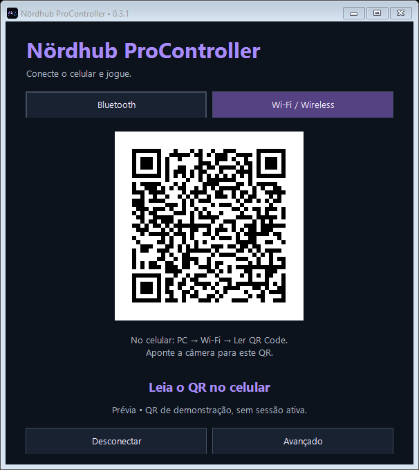

# Usar em desktops e notebooks Windows

O auxiliar Nördhub recebe os comandos do Android e apresenta um controle **Xbox 360/XInput** aos jogos Windows. Ele funciona independentemente de a Steam estar aberta. O jogo precisa oferecer suporte a controle.

## Programas necessários

| Programa/requisito | Download ou informação oficial |
|---|---|
| Windows 10/11 **x64** | Windows ARM, 32 bits, Linux e macOS não têm auxiliar nesta versão. |
| Nördhub ProController 0.3.1 no Android | [Baixar APK](https://github.com/EriclesSantos/nordhub-procontroller/releases/download/v0.3.1/nordhub-procontroller-0.3.1.apk). Android 9+. |
| Auxiliar Nördhub Windows 0.3.1 | [Baixar ZIP](https://github.com/EriclesSantos/nordhub-procontroller/releases/download/v0.3.1/nordhub-procontroller-pc-0.3.1.zip). Extraia todo o conteúdo. |
| .NET Framework 4.8 | [Download Microsoft](https://dotnet.microsoft.com/en-us/download/dotnet-framework/net48). Se já estiver disponível no Windows, não precisa reinstalar. |
| ViGEmBus x64 compatível | [Releases oficiais](https://github.com/nefarius/ViGEmBus/releases) e [instruções do autor](https://docs.nefarius.at/projects/ViGEm/How-to-Install/). |
| Bluetooth **ou** rede local | Bluetooth exige rádio no PC e HID Device no Android. Wi-Fi exige PC e telefone na mesma rede. O PC pode estar por cabo Ethernet. |

**ViGEmBus foi descontinuado.** Este auxiliar experimental depende dele para o Xbox virtual. Consulte o [comunicado do autor](https://docs.nefarius.at/projects/ViGEm/End-of-Life/). O driver é separado do ZIP e sua instalação é uma decisão do usuário; nenhum driver é instalado automaticamente.

## Preparar o auxiliar

1. Extraia o ZIP para uma pasta do PC. Mantenha `Nordhub.ProController.exe`, `ViGEmClient.dll` e `zxing.dll` juntos.
2. Confira os requisitos acima e abra `Nordhub.ProController.exe`.
3. Escolha Bluetooth ou Wi-Fi. Iniciar um modo encerra o outro neste auxiliar.
4. Inicie o controle antes de abrir o jogo. Ao trocar de dispositivo, alguns jogos precisam ser reabertos.

Fechar a janela mantém o auxiliar na bandeja do Windows. **Desconectar** remove o Xbox virtual; **Sair** encerra o programa. Ele não inicia com o Windows nem se instala como serviço.

## Conectar por Bluetooth

1. No app Android, selecione **PC → Bluetooth** ou **Parear novo**.
2. Autorize Dispositivos próximos, Bluetooth e visibilidade quando o Android solicitar. Volte para a tela do app.
3. Nas configurações Bluetooth do Windows, adicione o telefone e confirme o pareamento nos dois aparelhos.
4. Aguarde a confirmação da conexão HID no app e mantenha a tela do controle aberta.
5. No auxiliar, clique em **Bluetooth**. Se houver um único gamepad Nördhub/SwitchPhone, o auxiliar o seleciona. Se precisar escolher outro, abra **Avançado → Bluetooth**, selecione o gamepad do celular e clique em **Conectar**.
6. Aguarde **Conectado • pronto para jogar**. Para detalhes de botões e analógicos, abra **Avançado → Diagnóstico**. Em `Win+R → joy.cpl`, o gamepad e o Xbox virtual podem aparecer com nomes distintos.

O nome Bluetooth externo pode continuar sendo o nome do telefone. Os três desenhos do app enviam os mesmos comandos lógicos; escolha o desenho de sua preferência. Em uma sessão posterior, **Reconectar** reutiliza o vínculo salvo quando ele estiver disponível.

## Conectar por Wi-Fi / Wireless

1. Coloque o celular e o PC na mesma rede. O PC pode usar cabo Ethernet no mesmo roteador; a comunicação não precisa de internet.
2. Abra o auxiliar e clique em **Wi-Fi / Wireless**. Um QR Code aparece na janela.
3. No app Android, escolha **PC → Wi-Fi / Wireless → Ler QR Code do computador**.
4. Autorize a câmera quando solicitado e aponte para o QR. A câmera fecha ao concluir ou sair dessa tela.
5. Aguarde **Conectado • pronto para jogar** no PC e a confirmação no celular. Abra o jogo e use o controle Xbox virtual.

Não é preciso digitar IP, porta ou código no fluxo por QR. O app tenta os endereços locais incluídos no QR e usa aquele que responder com autenticação válida. O auxiliar mostra o nome informado pelo telefone depois da conexão.

### Câmera e privacidade

A leitura acontece no próprio celular com ZXing, sem servidor, envio ou gravação de imagens. A câmera é opcional e só é solicitada na tela de leitura. O QR contém os dados de pareamento da sessão; não compartilhe uma captura dele enquanto estiver em uso. O app não salva o código.

### Avançado e conexão manual

Se não quiser usar a câmera, abra **Avançado** no auxiliar para consultar IPv4, porta **26761/UDP** e código. No celular, abra **Avançado: conexão manual**, preencha esses dados e toque em **Conectar manualmente**. Se houver vários IPs, use o da rede compartilhada com o telefone.

No auxiliar, **Avançado** reúne escolha manual do gamepad Bluetooth, touchpad como mouse, movimento DSU, dados de conexão e diagnóstico. **Gerar novo QR** encerra a sessão atual e gera um novo código. Desconectar e iniciar Wi-Fi novamente também renova o código. O APK lembra somente IP/porta da última conexão. **Copiar diagnóstico** omite o código; **Copiar código** é separado.

Redes de convidados ou isolamento entre clientes podem impedir a conexão. Se o Windows solicitar acesso de rede, permita o auxiliar na rede privada que você está usando. Não é necessário abrir portas do roteador para a internet. O aplicativo não altera regras de firewall.

Prévia da janela do auxiliar, renderizada com QR de demonstração sem sessão ativa:

## Steam e jogos fora da Steam

Na Steam, confira o Xbox virtual em **Configurações → Controle**. Para jogos com suporte nativo a Xbox, use entrada de gamepad; se usar Steam Input, escolha um modelo **Gamepad** e confira os analógicos. [Documentação oficial Steam Input](https://partner.steamgames.com/doc/features/steam_controller/getting_started_for_players).

Fora da Steam, abra o jogo normalmente depois de iniciar o auxiliar e selecione controle/gamepad nas opções do jogo. Em emuladores, selecione o **Xbox 360 virtual** no jogador desejado e configure o mapeamento. A Steam não é um requisito do auxiliar.

## Ajustes e recursos adicionais

O [guia de recursos](recursos.md) explica perfis, gatilhos, giroscópio, vibração, touchpad e movimento DSU, incluindo as diferenças entre Bluetooth e Wi-Fi.

## Solução rápida

| Situação | Como resolver |
|---|---|
| Falta `ViGEmClient.dll` ou `zxing.dll` | Extraia o ZIP inteiro e execute o EXE de dentro da pasta extraída. |
| Auxiliar informa driver ausente | Confira o ViGEmBus compatível nos programas necessários. |
| Bluetooth não aparece como gamepad | Confirme destino PC, permissões e canal HID no app; atualize a lista do auxiliar. |
| Wi-Fi não confirma | Use a mesma rede, leia o QR atual e confira o acesso do auxiliar no firewall da rede privada. Para digitar dados, use Avançado. |
| Jogo vê o controle, mas não recebe comandos | Confira entradas em Avançado → Diagnóstico, dispositivo/mapeamento escolhido no jogo e reabra o jogo após iniciar o Xbox virtual. |
| Emulador mantém um controle antigo | Selecione o Xbox virtual no jogador correto e gere/refaça o mapeamento. |
| Entradas duplicadas | Confira se o jogo está usando simultaneamente o HID do telefone e o Xbox virtual. O auxiliar precisa continuar conseguindo ler o telefone. |
| Comandos parados após perder conexão | O auxiliar mantém o Xbox em neutro até o retorno da origem ou encerramento manual. |

Nome de dispositivo, contagem de pacotes e ícone da Steam não comprovam, por si só, resposta dentro do jogo. Use as opções de entrada do próprio jogo para conferir seu mapeamento.
